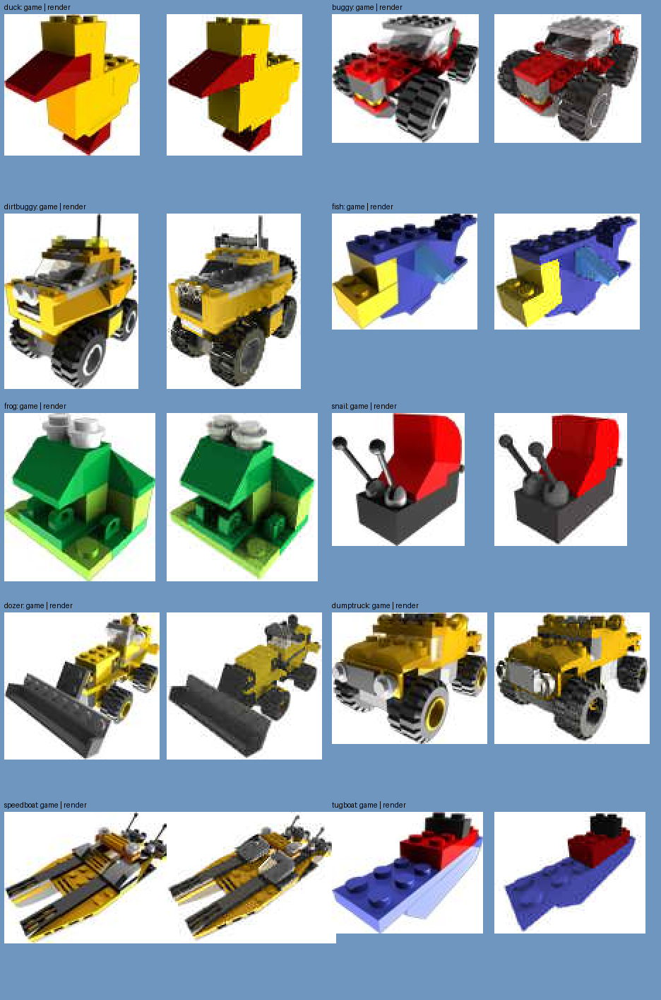
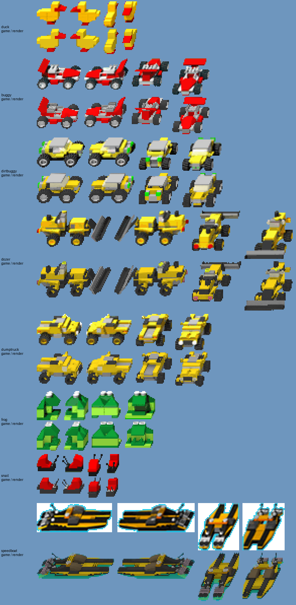
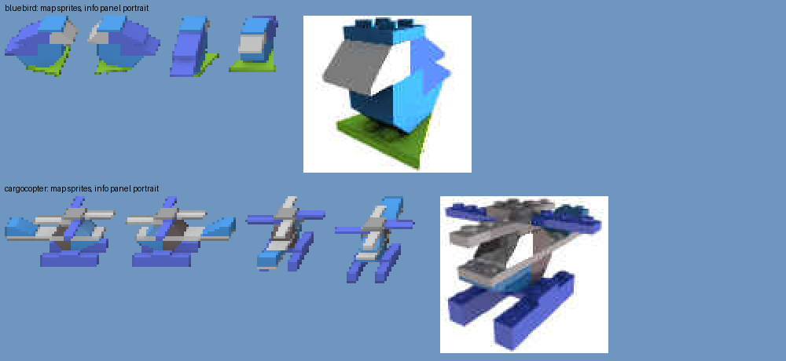
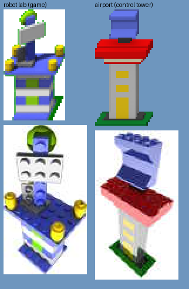
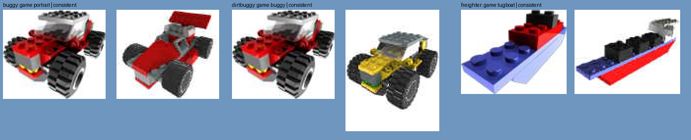

# LEGO World Builder sprite renderer

Sprites in the style of **LEGO World Builder** (Gamelab for The LEGO Group, 1999–2000), rendered
from LEGO models made in BrickLink's [Stud.io](https://www.bricklink.com/v3/studio/download.page)
or any LDraw editor: a unit turned to each of the game's four directions, lit and coloured as the
game's own sprites were, brought down to the game's size with its hard cut-out edge, and, for a
unit that swims, stood partly in the water as the game draws it.

It also renders the **info panel portraits**: the larger pictures of a unit the game shows when
it is selected, lit as the game's were lit (low lights, hard shadows, reflective plastic,
overexposed colour, mirroring glass, kept as JPEG), and the plans bar's icons.

The renderer was made against **JappaWakka's recreations** of the game's units. The cameras, the
lighting and the colours were all measured on the game's own sprites and portraits (see
[How close it comes](#how-close-it-comes)).

> **Status:** a good start, not finished. The renders sit close to the game's, but not
> pixel-perfect. Where they differ, it is mostly the recreations being built or posed differently
> from the game's models (see [AUDIT.md](AUDIT.md)). Its first use: the cut **Bluebird** and **Cargo
> Copter**, and an **Airport** to recharge the copter, made into playable units for the
> [online port](https://github.com/AgitationSkeleton/lego-worldbuilder-html5).



## Credits

- **The models** these tools were built and tuned with are **[JappaWakka](https://github.com/JappaWakka)**'s Stud.io recreations
  of World Builder's units, buildings and pickups (including the cut Bluebird and Cargo Copter),
  shared in their answer to
  [World Builder Game Units](https://bricks.stackexchange.com/questions/15211/world-builder-game-units)
  on Bricks Stack Exchange: [JappaWakka's answer](https://bricks.stackexchange.com/a/16711)
  ([Stack Exchange profile](https://bricks.stackexchange.com/users/19176/jappawakka), [GitHub](https://github.com/JappaWakka)). The models are theirs and
  are **not** included here: get them from the link in that answer.
- **LEGO World Builder** and its sprites are The LEGO Group's. No game data is included: the
  comparison tools read the game's sprites from your own copy (below). The showcase images in
  `docs/showcase/` show a few of the game's sprites and portraits beside the renders, for
  comparison.
- The renders of JappaWakka's models in the showcase (the buggy, the dirtbuggy, the bluebird, the
  cargo copter ...) are of their work.
- **The Airport** is our own: hand-built Stud.io models (`extra/`) after the airport in LEGO set
  4028, *World of Bricks*, the set the game's Cargo Copter comes from (an airport building, a
  control tower and runway lights). The Airport unit is the control tower.
- [ImportLDraw](https://github.com/TobyLobster/ImportLDraw) (Toby Nelson, GPL-2.0) imports the
  models into Blender; the [LDraw](https://www.ldraw.org/) parts library supplies the parts.
- [Blender MCP](https://github.com/ahujasid/blender-mcp) (Siddharth Ahuja) lets an AI assistant
  drive Blender while you work (optional).

LEGO is a trademark of the LEGO Group, which does not sponsor, authorise or endorse this project.

## What the game's sprites are like (and what this does about it)

Looking closely at the game's unit sprites (up to 8× and pixel by pixel) shows they were not
drawn by hand but rendered from 3D models and then cut out, which is what lets this work:

| The game's sprites | Here |
|---|---|
| An **oblique** view, as the map's tiles are drawn (a tile 50 px on in its row; each row 50 px down and 25 px left): what is further north is drawn further right, and upright edges stay upright. No real camera does that. | The model is sheared (`x' = x + skew·y`) after it is turned, and shot with an orthographic camera. Blender renders a sheared parent exactly, normals and all. |
| One model, turned a right angle per direction: **right** (east), **left** (west), **up** (north, away and to the right) and **down** (south, toward and to the left). | The turn for each direction, the camera's elevation, the skew and the size are fitted to the game's own sprites, unit by unit (`wbrender.fit`). The four turns are kept to one pattern so a unit alike from both sides isn't turned the wrong way. |
| **No studs** on the units' bricks: the duck's top and the buggy's spoiler are flat, and so are the buildings' roofs and bases. The pickup brick piles do show studs. The portraits show studs everywhere. | Studs are left out of the map sprites (empty stud parts are found before the library's), unless a model is marked `"studs": "full"` (the piles). Portraits are rendered with studs. |
| Strong, saturated colours, richer than LDraw's; no shadow on the ground. | Lit as the portraits are: each pixel's surface direction rendered, and a light rig, a palette and each unit's exposure fitted face by face on the game's own sprites (`wbrender/mapnormal.py`, `config/map_light.json`), composited in `wbrender/shade.py`. |
| A **hard edge** (no partial transparency), whose edge pixels still carry a little of the colour the render was smoothed against: magenta, white or grass green on land, **cyan** around a unit in water. | Rendered large, shrunk by averaging, its edge smoothed against a chosen backdrop colour, then cut out at a coverage threshold (`wbrender/post.py`). |
| A unit **in water** (`vehicle.duck.water.right` ...): the part below the waterline tinted toward the water's teal, deeper toward blue, with a cyan rim. | A waterline (a part of the model's height): below it the colour mixes toward the water's, and the edge is smoothed against cyan. For amphibious units (duck, frog, fish, gator) both sets are made. |

## The info panel portraits

The game's portraits were measured on the units whose recreations match the game's builds (the
duck, the buggy, the dirtbuggy, the fish, the frog, the snail, the dozer, the dump truck ...). Each
render was registered onto the game's portrait to the pixel and compared face by face:

- **Each portrait was lit on its own**, mostly by two low lights from either side, a little behind.
- **Hard cast shadows** from those lights.
- **Reflective plastic**, mirroring the model's other parts and a dark sky over a bright floor (the
  fish's jaw mirrors its head). With the low lights, this is why tops read darker than sides.
- **Overexposed**, each colour channel clipped on its own: a shaded yellow turns orange, a lit one
  stays lemon.
- **Glass** that greys and dims what is behind it and mirrors its surroundings, brightest toward
  its edges: the white bands across the windscreens.
- **Shine** on the tyres' rubber only (the rubber itself matte); slopes darker than smooth faces.
- **Kept as JPEG**: the white around each portrait rings with its noise.

How it is done: `wbrender/heronormal.py` renders the colours' ids, each pixel's surface direction,
the sky's light, each light's hard shadow and what each pixel reflects (a part, or a direction of
the world), then lights them in Python, so any light can be tried without rendering again.
`wbrender/herocam.py` fits each portrait's camera on the inside of the picture, roll included,
with no lens wider than 18 mm.

Which light a portrait gets:

| Portrait | Lit with |
|---|---|
| A unit the game has a portrait of | The rig fitted on that portrait, with its colours and exposure |
| A new unit (the bluebird, the cargo copter) | The rig of the game's portrait most like it (`hero_rig_from`: the duck's, the buggy's) |
| A *consistent* portrait, from the map's own model | The camera and rig of the game's portrait it stands for (`consistent_like`: the dirtbuggy's map model is the buggy's portrait build in yellow; the freighter's portrait in the game is the tugboat's, `hero_as`). The lens is kept to 30 mm or longer. |

A borrowed rig brings its exposure, matched to the model's median light, and its own colours. A
colour it never saw is carried over by ratio from the portraits that fitted both it and one of the
lender's colours (the game's yellows are lit far brighter than its reds), or else taken from the
world palette at the lender's scale.

The full write-up, with each unit's findings, is in [AUDIT.md](AUDIT.md).

## Setting up

You need Python 3.10+ with `numpy` and `Pillow`, and:

1. **Blender 4.2 LTS or later** ([blender.org](https://www.blender.org/download/); a portable zip is fine).
2. **The LDraw parts library**: [complete.zip](https://library.ldraw.org/library/updates/complete.zip), unzipped.
3. **ImportLDraw**: [the repository](https://github.com/TobyLobster/ImportLDraw), unzipped (the folder holding `loadldraw/`).
4. **JappaWakka's recreations**, from [their answer](https://bricks.stackexchange.com/a/16711).
5. For comparing and fitting: a checkout of the [LEGO World Builder HTML5 port](https://github.com/AgitationSkeleton/lego-worldbuilder-html5),
   with its data built from your copy of the game, for the game's sprites.

Copy `local.example.json` to `local.json` and fill in where these are (`local.json` stays on
your machine), then:

```sh
pip install numpy pillow
python -m wbrender.setup_models          # each unit's model from the recreations, into models/
python -m wbrender.extract_reference     # the game's sprites, into reference/ (for comparing)
```

## Using it

```sh
python -m wbrender.render duck buggy     # out/<unit>/: the sprites, compare.png, report.json
python -m wbrender.render all
python -m wbrender.fit crab              # fit a unit's camera to the game's sprites again
python -m wbrender.mapnormal fit         # the map sprites' light rig, palette and exposures
python -m wbrender.shade colours         # the rest of the palette, from every unit
python -m wbrender.models MY_MODEL.io --list
python -m wbrender.herocam duck          # fit a portrait's camera (turn, elevation, lens, roll)
python -m wbrender.heronormal rig duck --grey               # a game portrait's own rig: lights, shadows, reflections
python -m wbrender.heronormal glass                         # the glass, on the buggy's and dirtbuggy's windscreens
python -m wbrender.heronormal show duck buggy               # portraits beside the game's
python -m wbrender.render buggy --consistent-heroes         # portraits from the map's own models
python -m wbrender.posefit robot_lab 2460,2444 y --hero     # pose a joint as the game's model has it
python -m wbrender.audit                 # every unit against the game's, worst first
python -m wbrender.sheet out.png vehicle.duck.right vehicle.duck.water.right   # look at sprites, 6x
```

`out/<unit>/` gets the sprites under the game's own names (`vehicle.duck.right.png`,
`vehicle.duck.water.right.png`, `monster.crab.down.png`, ...), `compare.png` (the game's and the
render side by side, 4× size) and `report.json` (for each direction: how much the outlines overlap,
0 to 1, and the mean colour difference where they do).

### Your own models

Add a line to `config/units.json` (a name, the submodel, the sprite name, where it goes: `land`,
`water` or `both`), or use the Blender add-on below. A unit the game has no sprites of uses the
camera all the fitted units of its kind share. Other fields:

- `flies`: hovers so many pixels over a shadow on the map (the bluebird, the cargo copter).
- `hero_rig_from`: the game portrait whose lighting its portrait borrows.
- `consistent_like`: the game portrait a consistent portrait of it stands for.
- `pose`: joints turned as the game's model had them, `[{"match": part or submodel, "axis": "y",
  "angle": degrees, "pivot": [x, y, z]}]` (fitted with `wbrender.posefit`).
- `replace_parts`: parts swapped where a recreation takes a liberty with the game's build.

### The Blender add-on

`python tools/make_addon.py` builds `dist/wb_sprite_renderer.zip`; install it in Blender (Edit >
Preferences > Add-ons > Install from Disk) and set, in its preferences, where the LDraw library and
ImportLDraw are. The **WB Sprites** tab in the 3D view's sidebar then:

- opens a Stud.io `.io` or an LDraw file and lists its submodels; imports one, with or without studs;
- sets the game's look and camera (a fitted unit's, or the shared one), with the elevation, skew,
  size and each direction's turn to adjust;
- turns the model to each direction to look at; stands it in water, the waterline adjustable;
- renders the set and writes the game-sized sprites.

### Blender MCP (optional)

`.mcp.json` registers [Blender MCP](https://github.com/ahujasid/blender-mcp) for Claude Code in
this folder (it needs [uv](https://docs.astral.sh/uv/)). Install its `addon.py` in Blender, open
the BlenderMCP tab in the sidebar and start its server; an assistant can then look at and change
the scene while you work, the WB Sprites add-on's operators included (`bpy.ops.wb_sprites.*`).

## How close it comes

The map sprites, the game's above and the render below, each of the four directions:



Most well-matched units' outlines overlap the game's by 0.86 to 0.95. The colours come within the
game's palette.

The new units, rendered the same way. The bluebird and cargo copter fly, so their map sprites
hover over a shadow:



The Airport: the control tower of our own models after LEGO set 4028 (`extra/`), framed as the
game's robot lab is (its map camera, portrait camera and portrait lighting: `like` and
`hero_rig_from` in `config/units.json`) and brought to the size of its sprite:



The game's portraits are inconsistent: some show another build than the map's model (the buggy,
the dirtbuggy), and the freighter's shows the tugboat. With *consistent* portraits, each is
rendered from the map's own model instead, lit and framed as the game's portrait it stands for.
The dirtbuggy's map model is the buggy's portrait build in yellow, so the game's buggy portrait is
its reference:



What is still off, unit by unit, is in [AUDIT.md](AUDIT.md):
- the trex and the freezebot are posed otherwise;
- the shark's up and down sprites are drawn diagonally;
- the tugboat's portrait has stouter bricks than real ones;
- the dirtbuggy's front lights and the buggy's hubs are built differently.

## Layout

| | |
|---|---|
| `blender/wbsprite.py` | Everything inside Blender: import, look, waterline, skew, camera, shots, sprite cut-out |
| `blender/render_cli.py` | Blender's side of a command-line job |
| `addon/` | The Blender add-on (built with `tools/make_addon.py`) |
| `wbrender/` | The command line: models, reference sprites, fitting, rendering, comparing |
| `wbrender/shade.py`, `wbrender/mapnormal.py` | The map sprites' look: a light rig and palette fitted on the game's sprites, composited |
| `wbrender/heronormal.py` | The portraits: lighting rigs, shadows, reflections, glass, consistent portraits |
| `wbrender/herocam.py`, `wbrender/herofit.py` | The portraits' cameras |
| `wbrender/posefit.py` | Posing a recreation's joints as the game's model had them |
| `wbrender/audit.py`, `wbrender/lightprobe.py` | Every unit against the game's; where the portraits' lights stood |
| `config/units.json` | The units: model, sprite name, land or water, studs, pose, portrait borrowing |
| `config/style.json` | The look |
| `config/fit/` | Each unit's fitted camera and turns |
| `config/hero/` | Each portrait's fitted camera |
| `config/hero_light.json` | The portraits' lighting rigs (one per game portrait, one per kind), palettes, reflections and glass |
| `extra/airport_*.io`, `extra/airport_*.ldr` | Our own models: the Airport after LEGO set 4028 (building, control tower, runway lights, and all three together) |
| `tools/ldraw_check.py` | Checks a hand-made LDraw model is real LEGO: on the grid, nothing inside another, nothing in the air |
| `docs/showcase/` | The comparison images above (`python tools/showcase.py` makes them again) |

Not published, and ignored by git: `models/` (JappaWakka's), `reference/` (the game's),
`out/`, `work/`, `local.json`.

## Licence

The code is under the MIT licence (`LICENSE`). It includes no game data, no parts library and
none of JappaWakka's models. The only models it includes are our own Airport models in `extra/`.
